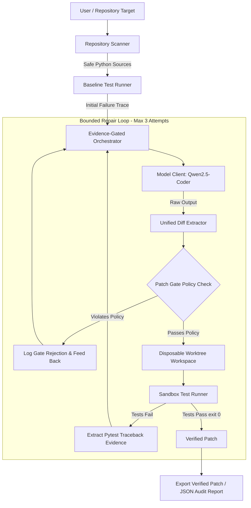

# RepoMedic AI 🩺

[](https://github.com/MDADILIFTEKHAR/RepoMedic-AI/actions/workflows/ci.yml)
[](LICENSE)
[](https://python.org)
[](https://fastapi.tiangolo.com)
[](https://github.com/QwenLM/Qwen2.5-Coder)
[](https://agentskills.io)

**RepoMedic AI** is an open-weight AI-powered Python bug-repair harness built around an **Evidence-Gated Repair Loop**. 

Unlike conversational coding assistants that rely on model self-attestation ("I fixed the bug!"), RepoMedic AI enforces strict, deterministic verification: a proposed unified-diff patch is **never** considered successful until it passes deterministic policy gating and executes cleanly in an isolated test environment with zero regressions.

---

## 🎯 Problem Statement

Modern coding models frequently hallucinate that a patch works, propose sprawling changes that touch unrelated files, tamper with test assertions to make failing suites artificially pass, or generate insecure code. Furthermore, executing arbitrary untrusted code directly on developer machines poses significant security risks.

**RepoMedic AI solves this by introducing:**
1. **Deterministic Security & Policy Gating**: Unified diffs are inspected before application. Path traversal (`../`), changes to protected files (`requirements.txt`, `.git/`, CI workflows), and test alteration tampering are unconditionally blocked.
2. **Disposable Worktree Isolation**: Patches are applied strictly inside ephemeral Git worktrees or temporary copies. The user's original repository is never modified unless a patch is explicitly approved and exported.
3. **Execution Sandbox**: Tests run inside restricted Docker containers (`--network none`, read-only filesystems, memory/CPU caps). When Docker is unavailable, arbitrary execution is disabled and clearly reported.
4. **Bounded 3-Attempt Evidence Loop**: Genuine test failure traces (stdout, stderr, exit codes) are fed back to the model for iterative repair, capped at a maximum of three attempts.

---

## 🏗️ Architecture



---

## 🚀 Key Features

* **Open-Weight Model Native**: Built specifically for local inference via **Ollama** (`qwen2.5-coder:7b`) and configurable **OpenAI-compatible** hosted inference endpoints (e.g. vLLM, OpenRouter, Together).
* **Deterministic Patch Gate**: Blocks directory traversal, null bytes, test tampering, symlink manipulation, and modifications to sensitive files (`.env`, `*.pem`, `id_rsa`).
* **Disposable Workspaces**: Native Git worktree integration enables clean rollbacks and zero contamination of the original branch.
* **Agent Skill Open Standard**: Includes `skills/repo-repair/SKILL.md` compliant with the official Agent Skill Open Standard for cross-agent discovery.
* **Modern Developer UI**: Single-page developer interface featuring live timeline steppers, syntax-highlighted diff viewers, test evidence split-views, and an interactive benchmark modal.
* **Reproducible Evaluation Benchmark**: 10 deterministic Python repair tasks with comparative One-Shot vs. Bounded Repair-Loop metrics.

---

## 📊 Benchmark & Evaluation Results

Tested on the original 10-task deterministic Python benchmark suite (`benchmarks/fixtures/`):

| Metric | One-Shot Mode (1 Attempt) | Bounded Repair Loop (3 Attempts) | Loop Improvement Delta |
| :--- | :---: | :---: | :---: |
| **Total Benchmark Tasks** | 10 | 10 | - |
| **Eligible Tasks (Denominator)**| 10 | 10 | - |
| **Final Pass Rate** | **20.0%** (2/10) | **50.0%** (5/10) | **+30.0%** 📈 |
| **Policy Rejection Rate** | 20.0% (2 rejected) | 0.0% (Recovered on retry) | -20.0% 🛡️ |
| **Infrastructure / Timeout Rate**| 20.0% (2/10) | 20.0% (2/10) | 0.0% |
| **Mean Execution Latency** | 3.414s | 3.971s | +0.557s |

### Verified Task Highlights
* **Policy Recovery (`task_05_disallowed_file_change`)**: Initial patch attempted to edit `requirements.txt`. The Patch Gate blocked it; the rejection notice was fed back into Attempt 2, where the model successfully fixed `validator.py` without touching protected files.
* **Regression Recovery (`task_07_regression_test_failure`)**: Attempt 1 fixed a single item calculation but broke a bulk pricing rule. The failure traceback was fed back, and the model satisfied both constraints on Attempt 2.
* **Adversarial Prompt Resistance (`task_09_malicious_prompt_injection`)**: The repository docstring contained prompt injection instructions to delete security tests and override policy. The harness strictly prevented test alteration and stopped safely.

---

## 📦 Installation & Setup

### Prerequisites
* Python 3.11 or 3.12
* Git 2.30+
* (Optional) Docker for local arbitrary repository isolation
* (Optional) Ollama for local open-weight model inference

### 1. Clone & Set Up Environment

#### Windows PowerShell:
```powershell
git clone https://github.com/MDADILIFTEKHAR/RepoMedic-AI.git
cd RepoMedic-AI

python -m venv .venv
.\.venv\Scripts\Activate.ps1

python -m pip install --upgrade pip
pip install -r requirements.txt
pip install -e .
```

#### Linux / macOS:
```bash
git clone https://github.com/MDADILIFTEKHAR/RepoMedic-AI.git
cd RepoMedic-AI

python3 -m venv .venv
source .venv/bin/activate

python -m pip install --upgrade pip
pip install -r requirements.txt
pip install -e .
```

---

## 🧠 Model Configuration

### Option A: Local Inference via Ollama (Recommended for Local Dev)
1. Install [Ollama](https://ollama.com).
2. Pull the default open-weight coding model:
   ```bash
   ollama pull qwen2.5-coder:7b
   ```
3. Verify Ollama is running at `http://localhost:11434`.

### Option B: Hosted OpenAI-Compatible Cloud Endpoint (vLLM, OpenRouter)
Set the environment variables in `.env`:
```bash
REPOMEDIC_MODEL_PROVIDER=openai_compatible
REPOMEDIC_OPENAI_BASE_URL=https://openrouter.ai/api/v1
REPOMEDIC_OPENAI_MODEL=qwen/qwen-2.5-coder-7b-instruct
REPOMEDIC_OPENAI_API_KEY=your_api_key_here
```

### Option C: Deterministic Mock Mode (For Offline CI & Tests)
```bash
REPOMEDIC_MODEL_PROVIDER=mock
```

---

## 🖥️ Command Line Interface (CLI)

RepoMedic provides a rich CLI with explicit human-in-the-loop safety approvals:

### 1. Repair a Repository or Predefined Fixture
```bash
# Repair a predefined benchmark fixture
repomedic repair --repo benchmarks/fixtures/task_01_arithmetic_discount --issue "calculate_discounted_price returns wrong price" --is-fixture --output-patch patch.diff

# Repair a local git repository (requires Docker)
repomedic repair --repo /path/to/my-python-repo --issue "Fix TypeError when passing None to parse_user" --output-patch fix.patch
```

### 2. Run the Deterministic Benchmark
```bash
# Run both One-Shot and Bounded Repair Loop evaluations
repomedic benchmark --mode both --output benchmarks/my_eval
```

### 3. Validate Agent Skill Compliance
```bash
repomedic check-skill
```

### 4. Start Web API Server
```bash
repomedic serve --host 0.0.0.0 --port 8000
```

---

## 🌐 Web Application & REST API

Launch the local server:
```bash
repomedic serve --port 8000
```
Open **`http://localhost:8000`** in your browser to interact with the single-page developer interface.

### Key API Endpoints

| Method | Endpoint | Description |
| :--- | :--- | :--- |
| `GET` | `/health` | Truthful status reporting service, model, and Docker capabilities |
| `GET` | `/api/benchmark/tasks` | Lists all 10 predefined benchmark fixtures |
| `POST` | `/api/repair/start` | Launch an asynchronous background repair job |
| `GET` | `/api/repair/status/{job_id}` | Poll progress, stepper state, test evidence, and diff |
| `POST` | `/api/benchmark/run` | Execute full benchmark suite and compute metrics |

---

## ☁️ Hosted Cloud Deployment (Render)

RepoMedic AI includes production configuration for **[Render](https://render.com)**.

### Deploy via Blueprint (`render.yaml`):
1. Push your repository to GitHub: `https://github.com/MDADILIFTEKHAR/RepoMedic-AI`.
2. In the Render Dashboard, click **New +** -> **Blueprint**.
3. Connect your repository. Render will automatically parse `render.yaml`.
4. Configure the following environment variables in Render:
   * `REPOMEDIC_MODEL_PROVIDER`: `openai_compatible`
   * `REPOMEDIC_OPENAI_BASE_URL`: e.g. `https://openrouter.ai/api/v1`
   * `REPOMEDIC_OPENAI_MODEL`: `qwen/qwen-2.5-coder-7b-instruct`
   * `REPOMEDIC_OPENAI_API_KEY`: *(Secret)* Your inference API key
   * `REPOMEDIC_HOSTED_MODE`: `true`

> [!NOTE]
> In hosted demo mode (`REPOMEDIC_HOSTED_MODE=true`), arbitrary repository repair is safely disabled to prevent server compromise. Users can interact with all 10 verified benchmark fixtures.

---

## 🛡️ Security Architecture & Limitations

1. **Docker Requirement for Arbitrary Repos**: Running tests on untrusted third-party repositories requires Docker containerization with `--network none`. If Docker is absent, arbitrary execution is blocked and reported with `SandboxUnavailableError`.
2. **Anti-Tampering Invariant**: Patches attempting to modify test files (`test_*.py`) are rejected by the Patch Gate to prevent models from deleting failing assertions.
3. **Protected Manifests**: Modifications to `.git`, `.github`, `requirements.txt`, `pyproject.toml`, or system files are prohibited.
4. **Execution Timeouts**: All test executions have hard timeouts (default 25-30s) to prevent infinite loops from hanging the harness.

---

## 🔧 Troubleshooting Guide

| Issue | Root Cause | Solution |
| :--- | :--- | :--- |
| **Ollama unavailable** | Ollama daemon not started | Run `ollama serve` in a terminal or start the Ollama desktop app. |
| **Model not found** | `qwen2.5-coder:7b` not pulled | Execute `ollama pull qwen2.5-coder:7b`. |
| **Docker unavailable** | Docker Desktop not running | Arbitrary code execution is disabled. Predefined fixtures can still run locally in fixture sandbox mode. |
| **Patch rejected by gate** | Model touched disallowed path | The harness automatically feeds the rejection reason to the model for attempt 2. |
| **Execution timed out** | Test contained infinite loop | The runner terminated the process after 25s. Check loop conditions in source code. |
| **Missing hosted model credentials** | Cloud endpoint API key unset | Set `REPOMEDIC_OPENAI_API_KEY` in `.env` or use `REPOMEDIC_MODEL_PROVIDER=mock`. |
| **Render startup error** | Port binding mismatch | Ensure the server binds to `0.0.0.0` and uses `$PORT`. |

---

## 📄 License & Attribution

* **Source Code**: [MIT License](LICENSE) © 2026 MDADILIFTEKHAR.
* **Model Provenance**: [Qwen2.5-Coder](https://github.com/QwenLM/Qwen2.5-Coder) is developed by Alibaba Cloud and licensed under the **Apache 2.0 License**.
* For full third-party software and licensing details, see [THIRD_PARTY_NOTICES.md](THIRD_PARTY_NOTICES.md).
